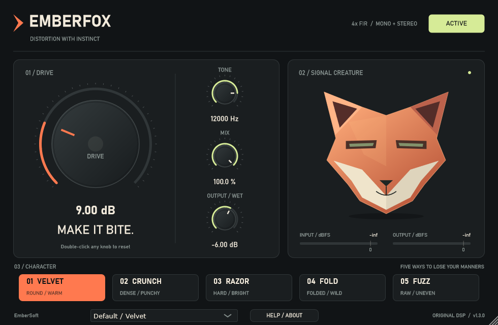
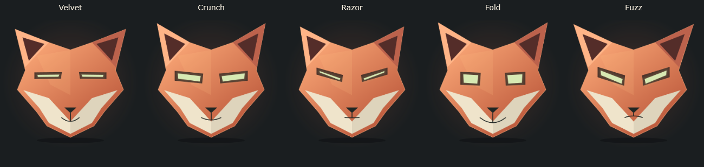

# EMBERFOX

Five distortion characters, a responsive Faceted fox and an immediate workflow. A Windows x64 VST3 effect and standalone application by **EmberSoft**, built with C++17, JUCE and CMake.



**Version 1.3.0 is an unsigned preview.** Download the installer, portable VST3/standalone bundle and complete corresponding source from [Releases](https://github.com/SeksiabiSimmu/EMBERFOX/releases). Clean-Windows installation and interactive DAW/audio-device testing remain pending.

## Features

- Five modes: Velvet saturation, Crunch soft clipping, Razor hard clipping, Fold wavefolding and asymmetric Fuzz.
- Drive, Tone, Mix, wet Output and bypass, with eight factory starting points.
- 4x FIR oversampling, smoothed parameters and 61 samples of reported, compensated latency.
- Mono/stereo float audio, DAW automation and complete project state restoration.
- Symmetrical vector expressions, independent input motion/output lighting, peak-hold meters and a resizable editor.
- Click-to-edit values, keyboard entry, double-click reset and offline Help/About.



## Install

Close the host before installing or updating. Run the unsigned setup from Releases and choose current-user or all-users installation, the VST3 directory and optional standalone. Setup checks the x64 Microsoft Visual C++ runtime and runs the bundled Microsoft-signed prerequisite only when needed. Windows administrator approval may be required.

For manual installation, extract the portable ZIP and copy the **entire `EMBERFOX.vst3` folder**, including `Contents`, into the host's VST3 directory:

- All users: `C:\Program Files\Common Files\VST3`
- Current user: `%LOCALAPPDATA%\Programs\Common\VST3`

Add a custom/current-user path to the host if needed, rescan and load EMBERFOX on an audio effect insert. The standalone application has its own audio-device settings. Uninstall through Windows Installed Apps. Shared runtimes and user-created files are retained.

## Controls

| Control | Behavior |
|---|---|
| Drive | 0–36 dB before distortion; default 9 dB. |
| Tone | 400 Hz–20 kHz low-pass after distortion, capped below Nyquist. |
| Mix | 0–100% wet, blended with latency-aligned dry audio. |
| Output / Wet | −24 to +6 dB on the wet signal only. At zero Mix, dry audio stays unchanged. |
| Mode | Velvet, Crunch, Razor, Fold and Fuzz; automatable with a 20 ms crossfade. |
| Bypass | Crossfades to latency-aligned dry audio with fixed latency. |

Click a value to type, press Enter to commit or Escape to cancel. Double-click a knob to reset it. Factory presets change the existing parameters and activate the effect; manual edits show **Custom**. **Default / Velvet** restores the original defaults.

Meters span −60 to +6 dBFS. Peak markers hold for one second, then fall at 18 dB/s; the 0 dBFS tick marks full scale. Input energy drives expression/movement and output energy independently drives eye brightness/glow. Editor sizes range from 770×503 to 1470×960, with 980×640 as the default.

There is no limiter or automatic loudness matching. Start at a moderate playback level. Wet filtering changes phase as well as timbre.

See the [offline guide](docs/customer/UserGuide.html), [system requirements](docs/customer/SystemRequirements.md), [support checklist](docs/customer/Support.md) and [changelog](docs/customer/Changelog.md).

## Build

Install Windows x64 Visual Studio C++ Build Tools, a Windows SDK, CMake and Ninja. The scripts discover Visual Studio through `vswhere` and currently select the complete MSVC 14.50 toolset. Adjust `-vcvars_ver` in `scripts/build.ps1` when using a different installed toolset.

```powershell
git clone https://github.com/SeksiabiSimmu/EMBERFOX.git
cd EMBERFOX
.\scripts\build.ps1
```

JUCE is pinned to **8.0.16-security**, commit `ea77444750de45e036e0279bb0291144bf8e3688`. CMake fetches that revision if no local dependency is present. The complete source package from Releases also includes `external/JUCE-source.zip`, which the build script expands automatically.

Outputs:

```text
build/msvc/Emberfox_artefacts/Release/VST3/EMBERFOX.vst3/
build/msvc/Emberfox_artefacts/Release/Standalone/EMBERFOX.exe
```

For an initialized x64 MSVC developer shell:

```powershell
cmake -S . -B build/manual -G "Ninja Multi-Config"
cmake --build build/manual --config Release --parallel 4
ctest --test-dir build/manual -C Release --output-on-failure
```

## Validate and package

Download official [pluginval 1.0.4](https://github.com/Tracktion/pluginval/releases/tag/v1.0.4) into `tools/pluginval/pluginval.exe`, then run:

```powershell
.\scripts\bootstrap-release-tools.ps1
.\scripts\validate.ps1
.\scripts\build-installer.ps1 -UnsignedPreview
.\scripts\test-installer.ps1
```

The bootstrap script pins/builds Steinberg's official validator and verifies Inno Setup/Microsoft runtime downloads by SHA256 and publisher signature. Validation requires six CTest suites, correct Windows product metadata, pluginval level 10 and direct/integrated Steinberg validation. Missing or skipped external validators fail normal release validation.

The installer smoke test uses isolated project destinations and a temporary current-user registration. It refuses to overwrite an existing installed registration. Its optional upgrade check uses a locally retained 1.2.1 ZIP when available.

The 1.3.0 binaries passed all six suites, pluginval level 10, Steinberg's 47 applicable tests and isolated installer lifecycle checks. See [validation](docs/validation/REPORT.md) for tolerances and limitations, and the [clean-Windows procedure](docs/clean-windows-test.md) for pending checks. These results do not establish compatibility with every DAW.

`package.ps1` creates portable binaries and complete corresponding source, including pinned JUCE source. The installer embeds that same source ZIP. Local paths in packaged documentation/logs are redacted; original test records remain local. Previous local release ZIPs are preserved for rollback.

For a future signed build, use `build-installer.ps1 -Thumbprint <certificate-thumbprint>` with the appropriate `-CertificateStore`. Signing requires a trusted code-signing identity and a verified timestamp. The current downloads are unsigned; the positive certificate-backed signing path remains untested.

## Source layout

| Path | Purpose |
|---|---|
| `Source/DistortionEngine.*` | Preallocated DSP, oversampling, smoothing, filtering and delay alignment. |
| `Source/PluginProcessor.*` | Parameters, state, buses, bypass and meter bridge. |
| `Source/PluginEditor.*` | Native controls, vector artwork and message-thread drawing. |
| `Source/FoxAnimation.h`, `Source/VisualState.h` | Time-based animation, mode poses and peak meters. |
| `Source/FactoryPresets.h`, `Source/ProductHelp.h` | Factory starting points and offline help. |
| `Tests/` | DSP, state, animation, actual VST3 host and native UI checks. |
| `scripts/`, `installer/` | Build, validation, packaging, signing and Windows setup. |

## License

**AGPL-3.0-only.** See [LICENSE.txt](LICENSE.txt) and [THIRD_PARTY.md](THIRD_PARTY.md). Complete corresponding project/JUCE source accompanies the downloadable binary releases. Preserve the applicable upstream notices. No commercial JUCE entitlement is assumed.
